# GateSathi UI/UX reference guide

15 generated visual references. These guide layout and hierarchy; they are not implemented screens or behavior specifications. Rebuild text and controls in code, apply Hindi translations there, use a single existing project logo, and follow the project’s actual authorization rules. Sample people and school data are illustrative. Generated shading, spacing and dimensions are not exact design tokens.

## 01 — Sign-in (all roles) 

Shared sign-in: reference for mobile/password fields, language toggle and restrained school branding.

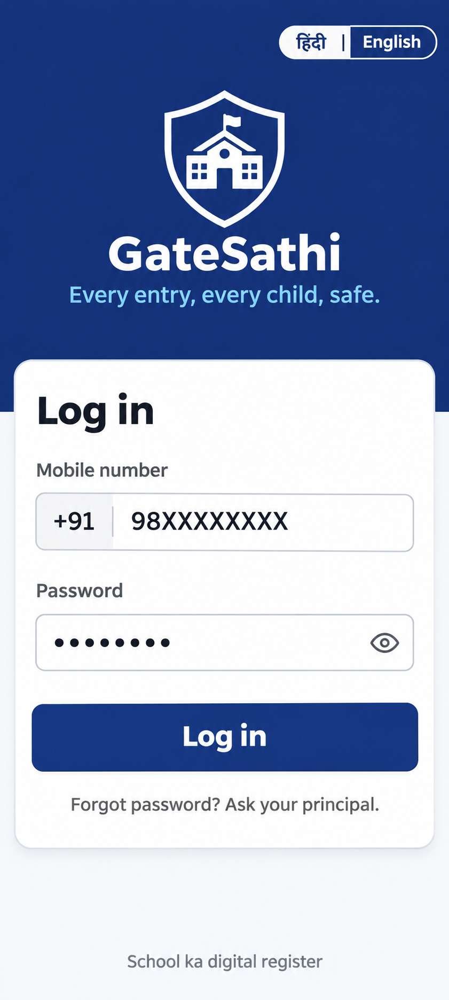

## 02 — Guard — home / visitor lookup (fastest path) 

Guard home: reference for phone-first lookup, pending approval chips and numeric keyboard.

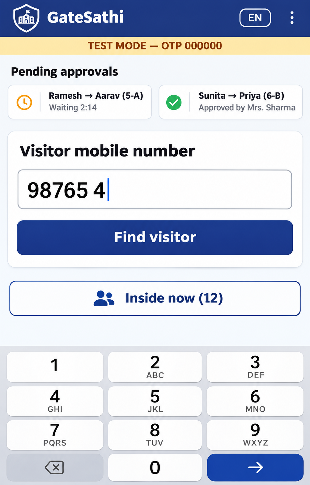

## 03 — Guard — known parent, one-tap entry 

Known guardian: reference for linked-child selection, purpose buttons and sticky Save entry action.

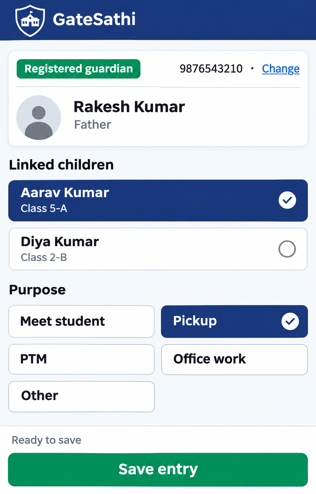

## 04 — Guard — new / unlisted visitor (pickup needs approval) 

Unlisted visitor: reference for photo capture, relation validation, student search and approval warning. Preserve the original purpose options; generated options vary.

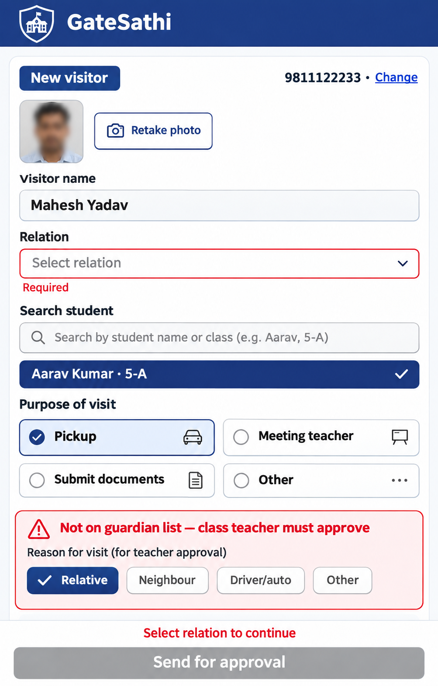

## 05 — Guard — waiting for teacher 

Waiting request: reference for elapsed time, escalation countdown, request summary and office contact.

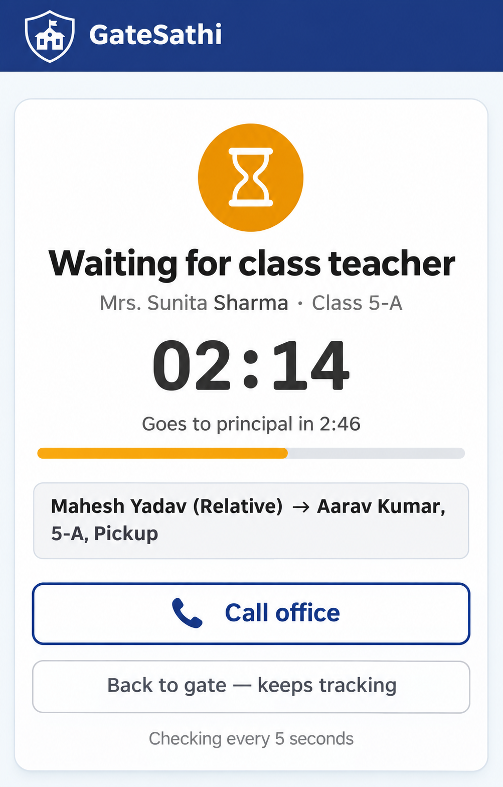

## 06-approved — Guard — decision result (make 3 variants) APPROVED

Approved result: reference for large green confirmation, approver attribution and next-entry action.

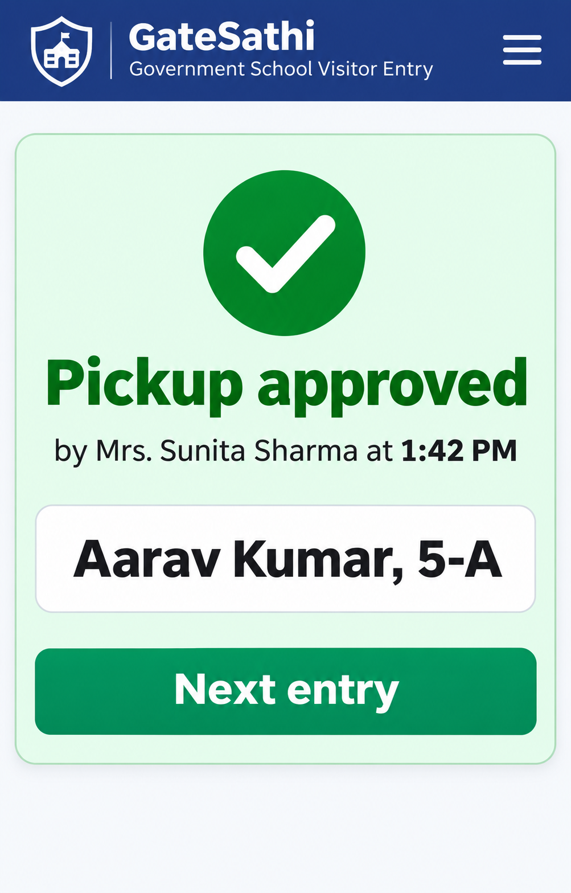

## 06-rejected — Guard — decision result (make 3 variants) REJECTED

Rejected result: reference for explicit refusal, teacher reason and do-not-release instruction.

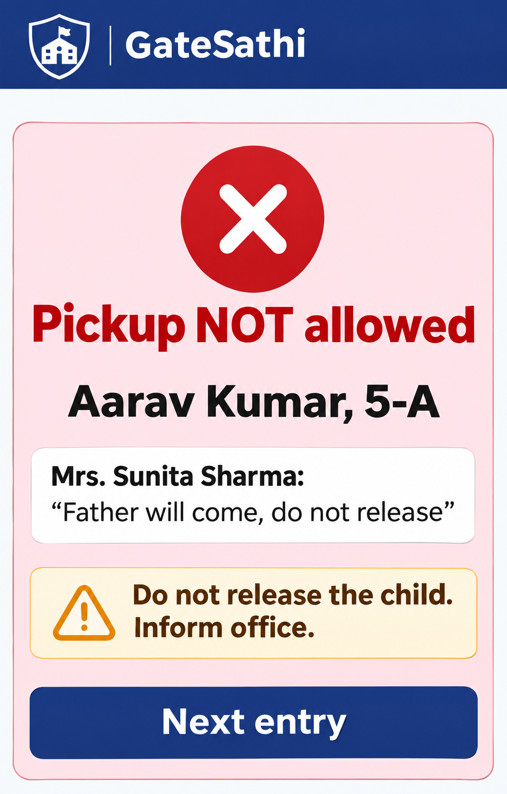

## 06-expired — Guard — decision result (make 3 variants) EXPIRED

Expired result: reference for neutral timeout state and office escalation action.

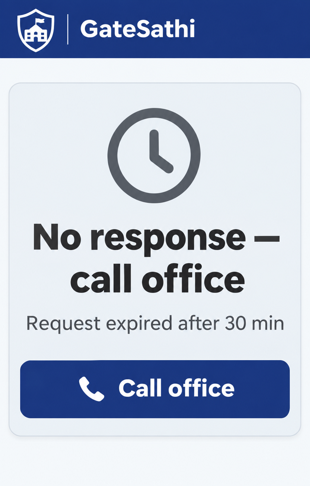

## 07 — Guard — inside now 

Inside now: reference for visitor rows, time on campus, overdue badge and exit confirmation. Repeated sample identities are illustrative.

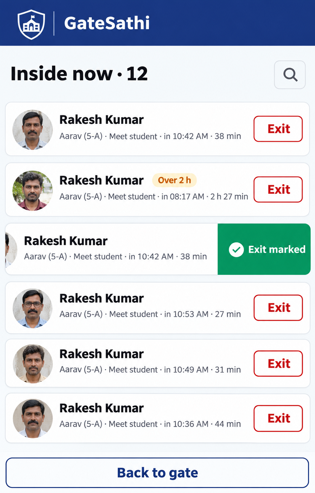

## 08 — Teacher — the "buzzer" (incoming approval, full-screen) 

Teacher incoming request: reference for visitor/child hierarchy, guardian warning and large approve/reject actions. Future-guardian approval needs a separate deliberate choice.

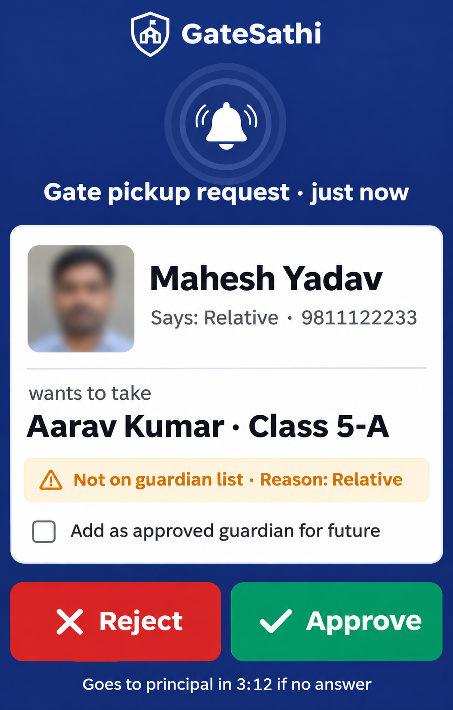

## 09 — Teacher — lock-screen push notification 

Lock-screen notification: reference for notification content and action hierarchy; actual appearance and actions depend on platform support.

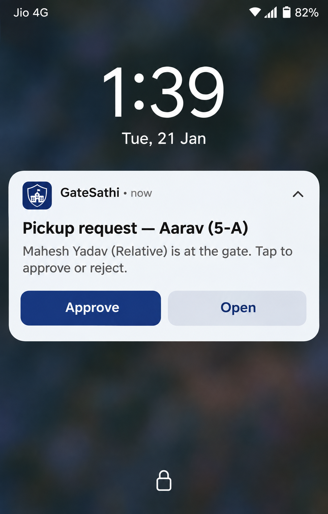

## 10 — Teacher — portal home 

Teacher portal: reference for pending/history navigation, notification status and compact decision card.

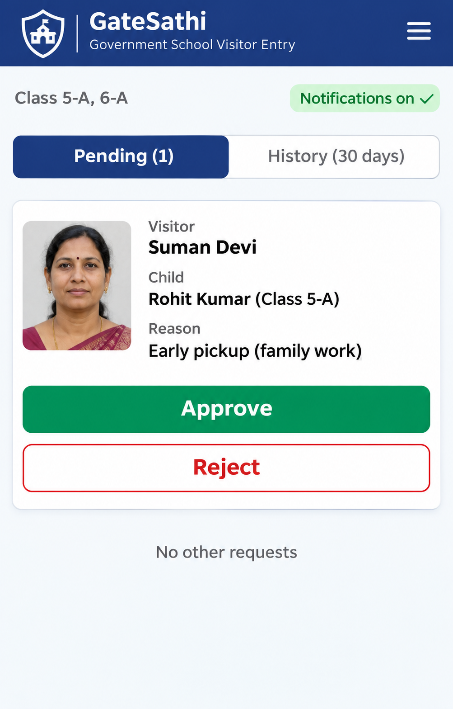

## 11 — Principal — dashboard (mobile) 

Principal mobile: reference for summary counts, notification problems, escalated approvals and bottom navigation.

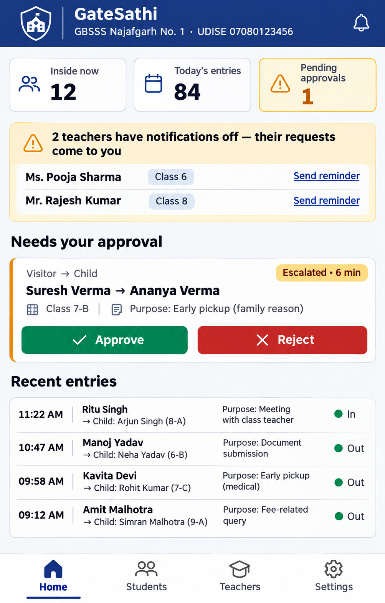

## 12 — Principal — dashboard (desktop, 1440×900) 

Principal desktop: reference for sidebar, gate-log table and approval panel. Replace invented school/sample details with actual data.

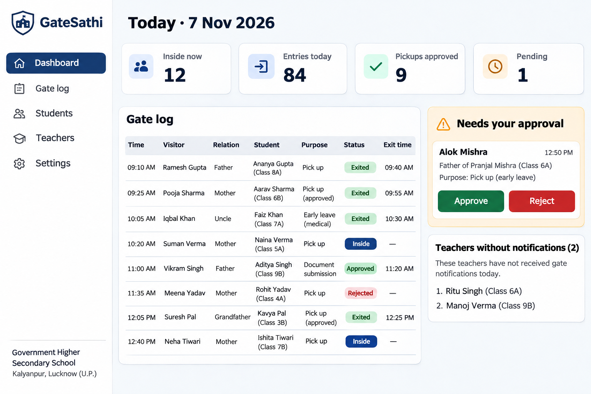

## 13 — Principal — student import 

Student import: reference for column mapping, row validation, error export and partial valid-row import. Use the desktop dashboard sidebar consistently; this output is portrait rather than the requested landscape.

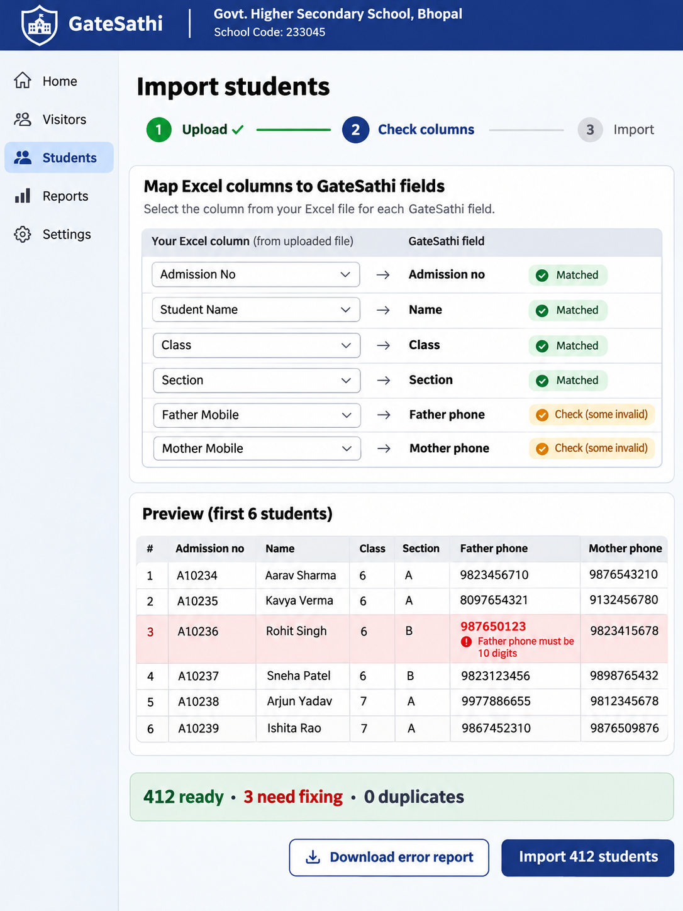

